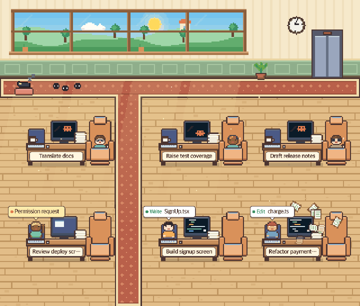
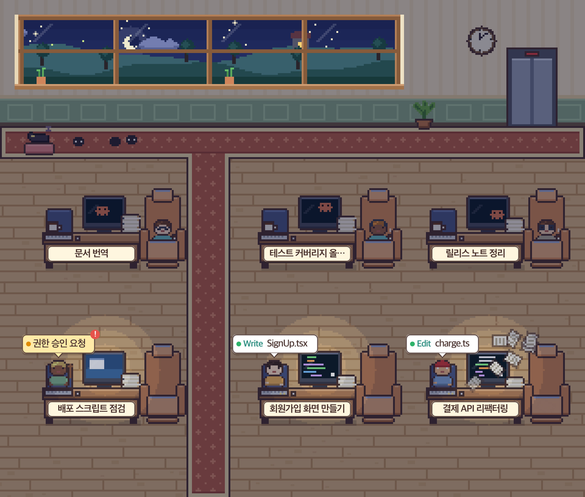
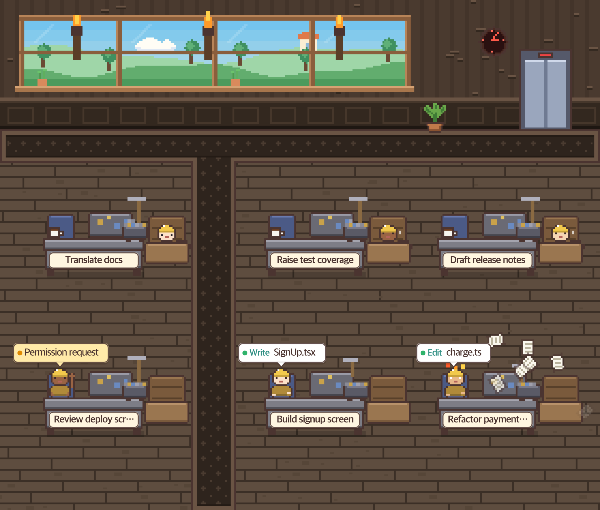
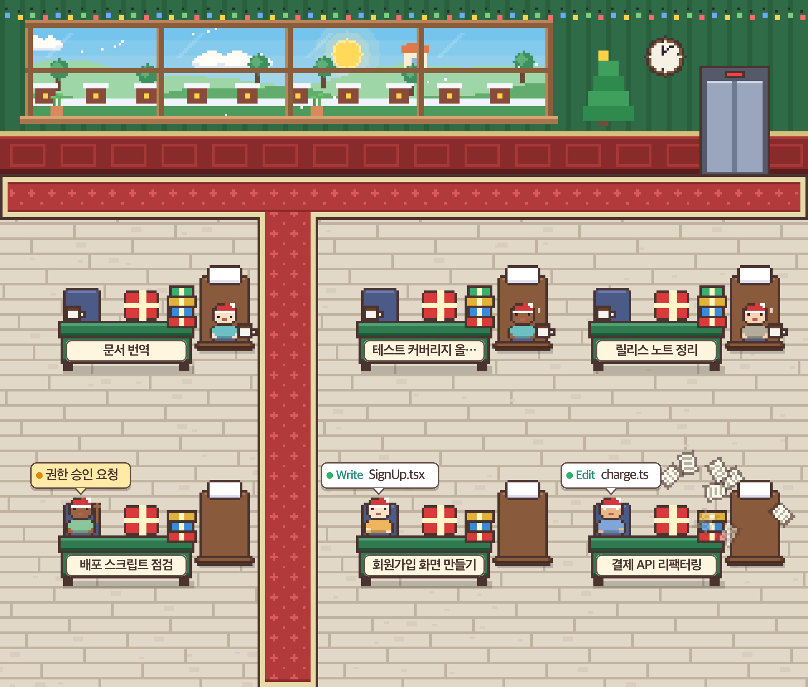

<div align="center">

# Claude Office

**See your Claude Code sessions as employees in a pixel-art office.**

A macOS menu bar app. Every running session gets a desk, and what the session is doing shows up as what the employee is doing.

[](https://github.com/woogisfree/claude-office/actions/workflows/test.yml)
[](LICENSE)


[](https://github.com/woogisfree/claude-office/stargazers)

[Highlights](#highlights) •
[Quick start](#quick-start) •
[What you see](#what-you-see) •
[Usage limits](#usage-limits) •
[How it works](#how-it-works) •
[Development](#development)



<sub>Screenshots use fake demo sessions, not real ones.</sub>

</div>

## Highlights

- **Glanceable**: know which sessions are working, waiting for you, or idle without switching windows.
- **Click to jump**: select a session and land in its terminal tab or its Claude desktop chat.
- **Lightweight and local**: a dependency-free Node server that only reads `~/.claude` and listens on `127.0.0.1`.
- **Alive**: the view outside the window follows sunrise, sunset, and weather for the city you pick from the menu (Seoul, Tokyo, New York, London, or Sydney), and the wall clock shows that city's local time. Idle employees even wear party hats on Friday evenings.

> **Disclaimer**: This is an unofficial personal project and is not affiliated with Anthropic. "Claude" and "Claude Code" are trademarks of Anthropic.

## Quick start

Requirements: macOS 13+ (Apple Silicon or Intel), Node.js 18+, and a Swift compiler (Xcode or `xcode-select --install`).

```bash
git clone https://github.com/woogisfree/claude-office
cd claude-office
./build.sh
```

`./build.sh` checks that Swift and Node are installed (and tells you how to get them if not), builds the app, and launches it. If the app is already running, it quits the old one and opens the new build. Use `./build.sh --no-open` to build only.

To install into `/Applications`, quit the app and copy it:

```bash
cp -R "build/Claude Office.app" /Applications/
```

The app is built with `swiftc` and signed ad hoc, with no Xcode project. No signed release binary is provided, so build it yourself. A locally built app is not blocked by Gatekeeper.

## What you see

| Status | Employee behavior |
|---|---|
| Working | Sits at the desk and types, alternating hands. The monitor shows code. |
| Caffeine rush | Weighted token rate above 120k per minute (see [Token counts](#token-counts)): wide eyes, shaking, and papers bursting off the stack. |
| Waiting for approval | Raises a hand and shows a speech bubble. The monitor turns blue. |
| Idle | Walks along the aisles to the recliner. A small logo bounces on the monitor. |
| Finished | Walks to the door and goes home. |

Employees only walk along the aisles and side paths, never through desks.

<p align="center">
  
  
  
</p>

More features:

- Hover anywhere over an employee or their desk area (monitor, recliner, name tag) to highlight that session.
- Click a session card to jump to it. Terminal sessions (tmux, cmux, Ghostty, iTerm) open the matching window and tab. Claude desktop app sessions open through the app's `claude://code/continue?session=local_…` link, which is an internal route that is not in the official docs and may change with an app update.
- Session panel with filters and token usage.
- Themes: office, mine, Christmas.
- Notifications when a working session finishes or waits for approval.
- Desk spacing adapts to the window size.
- The interface follows your system language (Korean or English).

## Auto clock-out

Desktop app sessions keep their process alive while they are open, so a session you finished with yesterday can still be sitting in the office. Choose **Auto Clock-Out** in the menu bar menu (Off, or after 2, 4, or 8 hours idle) to send them home.

- It is off by default.
- Only resting sessions leave: the time counts from when the session became idle. A session that is working or waiting for approval never leaves, and neither does a session whose subagent or teammate is still working.
- Nothing is stopped. The session keeps running, and the employee walks back in as soon as it works or asks for approval again.
- Sessions that left are folded into one row under the cards ("N sessions clocked out"). Click the row to list them, and click a session to jump to it.

## Token counts

Two different numbers are derived from the `usage` field of each assistant message in the transcripts, subagents included.

- **Tokens on a session card**: today's plain input plus output tokens. Cache reads and cache writes are not counted, because cache reads are usually most of the traffic and would hide the work actually done.
- **Caffeine rush rate**: a weighted sum over the last 5 minutes, per minute. Input counts 1x, cache writes 1.25x, cache reads 0.1x, and output 5x, so the rate follows roughly what the requests cost. The threshold is fixed at 120k weighted tokens per minute.

These are estimates read from local files, not billing figures.

## Usage limits

The remaining percentage of the 5-hour and weekly limits is read from two sources:

1. A cache file, `~/.claude/.statusline-ratelimit-cache`, that your Claude Code [status line](https://code.claude.com/docs/en/statusline) script writes. Claude Code does not create this file by itself, so add the snippet below to your script.
2. claude.ai's internal usage API, called with the session you create through **claude.ai login** in the menu.

### Writing the cache from your status line

Claude Code passes the status line script a JSON object on stdin, and its `rate_limits` field holds the 5-hour and 7-day usage. Add these lines to your status line script (they need [`jq`](https://jqlang.org)). If your script has no `input` variable yet, read stdin once at the top with `input=$(cat)`.

```bash
# Claude Office: save the 5-hour and weekly usage as "pct|resets_at|pct|resets_at".
five_pct=$(echo "$input" | jq -r '.rate_limits.five_hour.used_percentage // empty')
five_reset=$(echo "$input" | jq -r '.rate_limits.five_hour.resets_at // empty')
week_pct=$(echo "$input" | jq -r '.rate_limits.seven_day.used_percentage // empty')
week_reset=$(echo "$input" | jq -r '.rate_limits.seven_day.resets_at // empty')
if [ -n "$five_pct$week_pct" ]; then
  cache="$HOME/.claude/.statusline-ratelimit-cache"
  # Write to a temporary file and rename it, so the app never reads a half-written line.
  printf '%s|%s|%s|%s\n' "$five_pct" "$five_reset" "$week_pct" "$week_reset" > "$cache.tmp.$$" && mv -f "$cache.tmp.$$" "$cache"
fi
```

If you have no status line yet, save the lines above with `input=$(cat)` on top as `~/.claude/statusline-command.sh`, and point `statusLine` in `~/.claude/settings.json` at it:

```json
"statusLine": { "type": "command", "command": "bash ~/.claude/statusline-command.sh" }
```

Limits of this source:

- According to the status line docs, `rate_limits` is only sent to claude.ai Pro, Max, and Ultra subscribers. On other plans or with an API key the file is never written, and the claude.ai usage API below is the only source.
- It appears only after the first API response in a session, and the file is updated only while some session's status line runs.

### claude.ai usage API

The second source is an **unofficial endpoint that is not in any official documentation**. It may change or stop working without notice, and you use it at your own risk. The login cookie is stored only in the app's WebKit storage and is never sent anywhere else. **Log out** in the menu deletes it. If a fetch fails, the last value stays visible, dimmed, with how long ago it was read.

## How it works

| Layer | Technology |
|---|---|
| App shell | Swift (AppKit, WKWebView) |
| Local server | Node.js, dependency-free `node:http` |
| UI | Vanilla JS, Canvas 2D |

The server reads session transcripts and process info from `~/.claude`, derives each session's status and token rate, and serves a small JSON API plus the UI. The app shell hosts the UI in a WKWebView and adds the menu bar item, notifications, and session focusing.

The only external network traffic is Open-Meteo (weather and sunrise times for the selected city) and the claude.ai call described above.

```
app/      Swift app shell, Info.plist, icon
server/   Node server (server.mjs) and UI (public/)
build.sh  App bundle build script
docs/     README screenshots
```

## Development

Run the server on its own to work on the UI in a browser:

```bash
PORT=0 node server/server.mjs
```

Run the tests (Node's built-in runner, no installation needed). They cover token aggregation, transcript parsing, and the layout calculation:

```bash
npm test
```

## License

[MIT](LICENSE)
