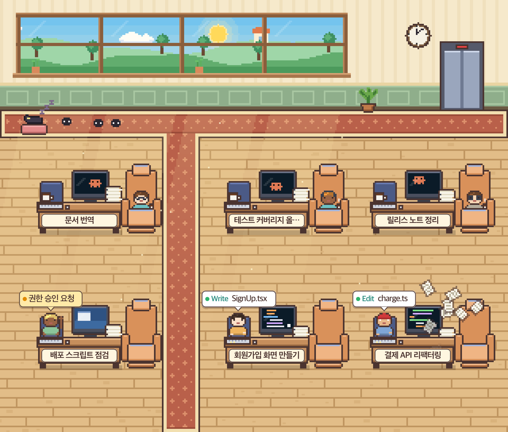

<div align="center">

# Claude Office

**See your Claude Code sessions as employees in a pixel-art office.**

A macOS menu bar app. Every running session gets a desk, and what the session is doing shows up as what the employee is doing.

[](LICENSE)


[](https://github.com/woogisfree/claude-office/stargazers)

[Highlights](#highlights) •
[Quick start](#quick-start) •
[What you see](#what-you-see) •
[Usage limits](#usage-limits) •
[How it works](#how-it-works) •
[Development](#development)



<sub>Screenshots use fake demo sessions, not real ones.</sub>

</div>

## Highlights

- **Glanceable**: know which sessions are working, waiting for you, or idle without switching windows.
- **Click to jump**: select a session and land in its terminal tab or its Claude desktop chat.
- **Lightweight and local**: a dependency-free Node server that only reads `~/.claude` and listens on `127.0.0.1`.
- **Alive**: day and night follow your real sunrise, sunset, and weather. Idle employees even wear party hats on Friday evenings.

> **Disclaimer**: This is an unofficial personal project and is not affiliated with Anthropic. "Claude" and "Claude Code" are trademarks of Anthropic.

## Quick start

Requirements: macOS 13+ (Apple Silicon or Intel), Node.js 18+, and a Swift compiler (Xcode or `xcode-select --install`).

```bash
git clone https://github.com/woogisfree/claude-office
cd claude-office
./build.sh
```

`./build.sh` checks that Swift and Node are installed (and tells you how to get them if not), builds the app, and launches it. If the app is already running, it quits the old one and opens the new build. Use `./build.sh --no-open` to build only.

To install into `/Applications`, quit the app and copy it:

```bash
cp -R "build/Claude Office.app" /Applications/
```

The app is built with `swiftc` and signed ad hoc, with no Xcode project. No signed release binary is provided, so build it yourself. A locally built app is not blocked by Gatekeeper.

## What you see

| Status | Employee behavior |
|---|---|
| Working | Sits at the desk and types, alternating hands. The monitor shows code. |
| Caffeine rush | Token rate above the threshold: wide eyes, shaking, and papers bursting off the stack. |
| Waiting for approval | Raises a hand and shows a speech bubble. The monitor turns blue. |
| Idle | Walks along the aisles to the recliner. A small logo bounces on the monitor. |
| Finished | Walks to the door and goes home. |

Employees only walk along the aisles and side paths, never through desks.

<p align="center">
  
  
  
</p>

More features:

- Hover anywhere over an employee or their desk area (monitor, recliner, name tag) to highlight that session.
- Click a session card to jump to it. Terminal sessions (tmux, cmux, Ghostty, iTerm) open the matching window and tab. Claude desktop app sessions open through the app's `claude://code/continue?session=local_…` link, which is an internal route that is not in the official docs and may change with an app update.
- Session panel with filters and token usage.
- Themes: office, mine, Christmas.
- Notifications when a working session finishes or waits for approval.
- Desk spacing adapts to the window size.

## Usage limits

The remaining percentage of the 5-hour and weekly limits is read from two sources:

1. The cache file written by the Claude Code status line script (`~/.claude/.statusline-ratelimit-cache`).
2. claude.ai's internal usage API, called with the session you create through **claude.ai login** in the menu.

The second source is an **unofficial endpoint that is not in any official documentation**. It may change or stop working without notice, and you use it at your own risk. The login cookie is stored only in the app's WebKit storage and is never sent anywhere else. **Log out** in the menu deletes it. If a fetch fails, the last value stays visible, dimmed, with how long ago it was read.

## How it works

| Layer | Technology |
|---|---|
| App shell | Swift (AppKit, WKWebView) |
| Local server | Node.js, dependency-free `node:http` |
| UI | Vanilla JS, Canvas 2D |

The server reads session transcripts and process info from `~/.claude`, derives each session's status and token rate, and serves a small JSON API plus the UI. The app shell hosts the UI in a WKWebView and adds the menu bar item, notifications, and session focusing.

The only external network traffic is Open-Meteo (weather and sunrise times) and the claude.ai call described above.

```
app/      Swift app shell, Info.plist, icon
server/   Node server (server.mjs) and UI (public/)
build.sh  App bundle build script
docs/     README screenshots
```

## Development

Run the server on its own to work on the UI in a browser:

```bash
PORT=0 node server/server.mjs
```

Run the tests (Node's built-in runner, no installation needed). They cover token aggregation, transcript parsing, and the layout calculation:

```bash
npm test
```

## License

[MIT](LICENSE)
